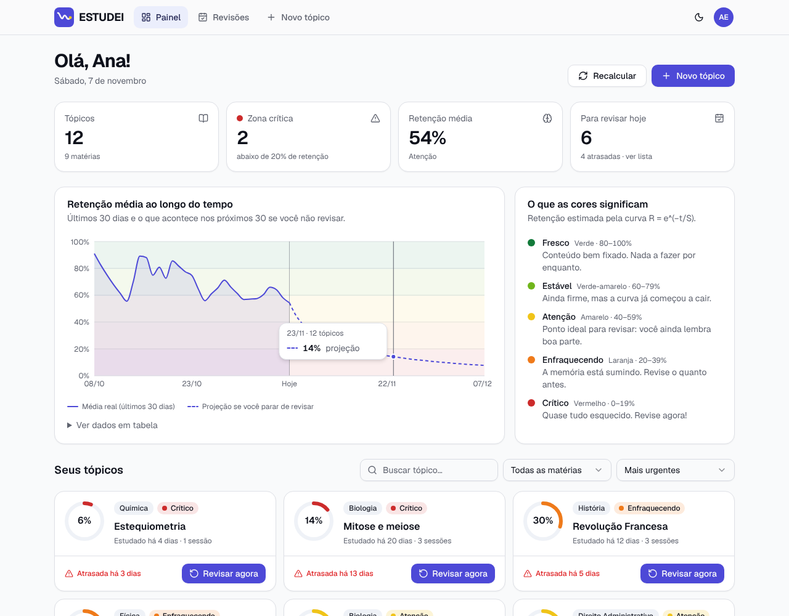
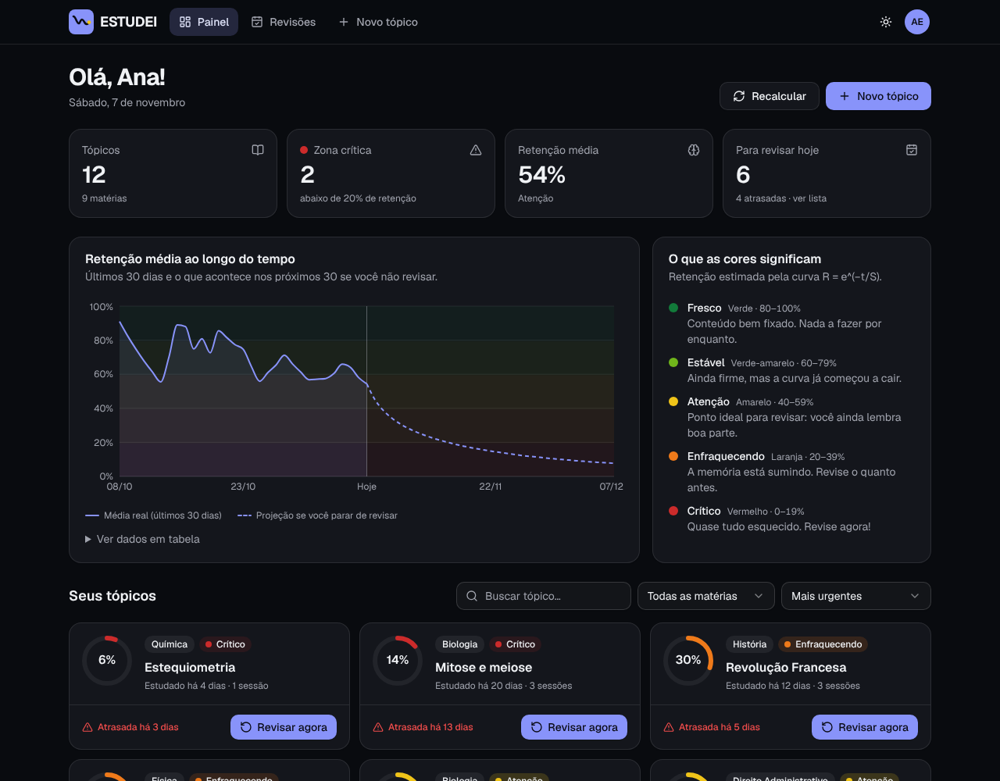
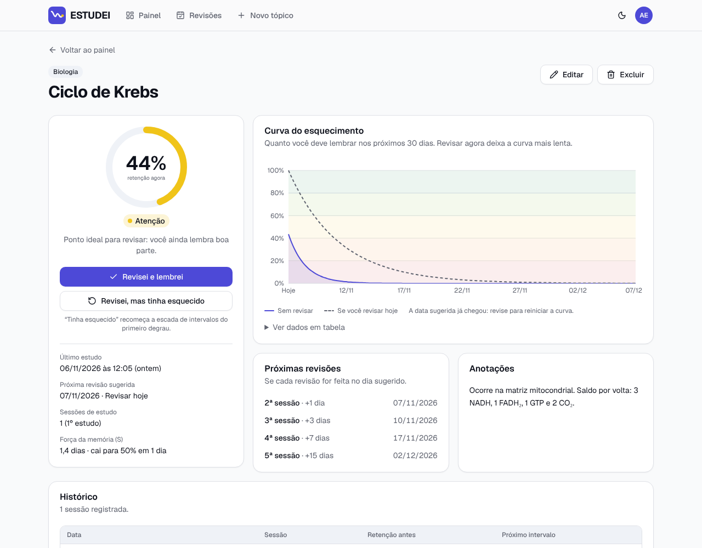
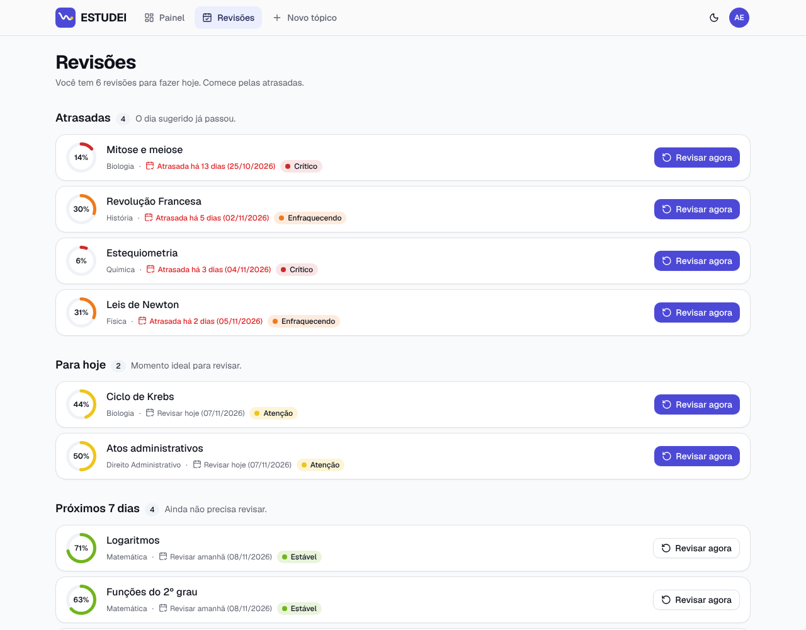
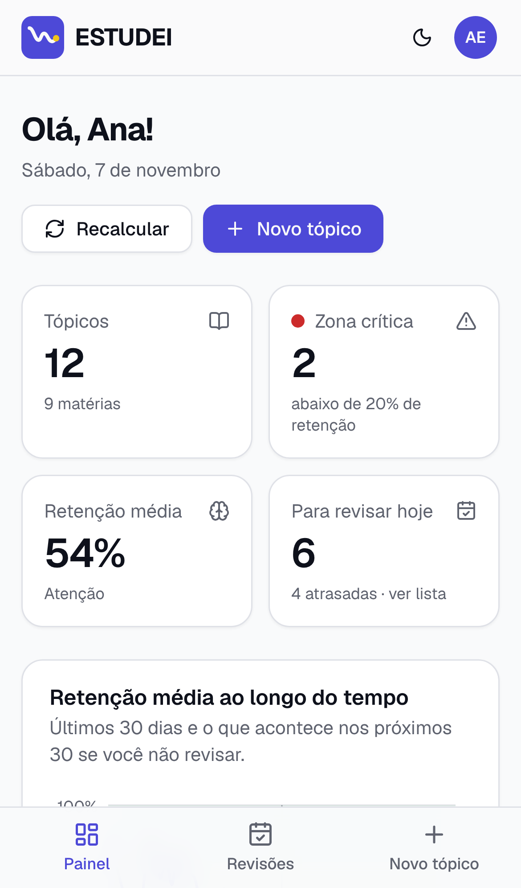

# ESTUDEI

Organizador de estudos baseado na **curva do esquecimento de Ebbinghaus**. Cada tópico estudado tem uma
**retenção estimada** que cai com o tempo; um sistema de cores (verde → amarelo → laranja → vermelho) mostra o que
está fresco na memória e o que precisa de revisão. As revisões seguem a repetição espaçada (1, 3, 7, 15 e 30 dias).

Interface 100% em português do Brasil, pensada para estudantes a partir de 18 anos.

| Painel (claro) | Painel (escuro) |
| --- | --- |
|  |  |

| Tópico | Revisões | Celular |
| --- | --- | --- |
|  |  |  |

## Funcionalidades

- **Tópicos de estudo**: cadastro, edição e exclusão (título, matéria, anotações, data do último estudo e número de
  sessões). Cada usuário vê apenas os próprios tópicos.
- **Motor da curva do esquecimento**: `R = e^(−t/S)` com força de memória crescente a cada revisão
  ([detalhes](#a-matemática)). Retenção de 0 a 100% e uma faixa de cor por tópico.
- **Painel**: cartões com anel de progresso colorido, ordenados por urgência (menor retenção primeiro), busca,
  filtro por matéria, outras ordenações e o botão **Revisar agora** (com **Desfazer**).
- **Resumo**: total de tópicos, tópicos na zona crítica, retenção média e revisões para hoje (com atrasadas).
- **Agenda de revisões**: seções **Atrasadas**, **Para hoje**, **Próximos 7 dias** e **Mais adiante**.
- **Gráficos** (Recharts): curva de cada tópico nos próximos 30 dias, comparada com a curva caso você revise hoje, e
  a **tendência de retenção média** (30 dias de histórico real + 30 dias de projeção). Ambos com tooltip e tabela de
  dados acessível.
- **Recalcular**: a retenção é calculada a cada carregamento de página, continua caindo ao vivo (atualiza a cada
  minuto), pode ser recalculada sob demanda e por um job agendado.
- **Autenticação** por e-mail e senha (cadastro com confirmação de 18+, login, logout), com sessão JWT em cookie
  `httpOnly`.
- **Tema claro/escuro** sem "piscar" ao carregar, layout responsivo com barra de navegação inferior no celular e
  legenda explicando as cores.

## Stack

| Camada | Tecnologia |
| --- | --- |
| Front-end | Next.js 16 (App Router, Cache Components) · React 19 · TypeScript · Tailwind CSS 4 · componentes no padrão shadcn/ui (Radix UI) · Recharts |
| Back-end | Route Handlers do Next.js (`src/app/api`) |
| Banco | PostgreSQL + Prisma 7 (driver adapter `pg`) |
| Autenticação | JWT próprio (`jose`) em cookie `httpOnly` + senhas com `bcryptjs` |
| Validação | Zod 4 (schemas compartilhados entre formulários e API) |
| Testes | Vitest |

## Como rodar localmente

**Pré-requisitos:** Node.js 20.19+ (recomendado 22) e PostgreSQL 14+ (ou Docker).

```bash
cd estudei
```

```bash
npm install
```

```bash
cp .env.example .env
```

Edite o `.env` e troque `AUTH_SECRET` por um valor aleatório (mínimo 32 caracteres):

```bash
openssl rand -base64 32
```

Suba o PostgreSQL. Se não tiver um instalado, use o Docker Compose incluído (usuário, senha e banco `estudei`,
compatível com o `DATABASE_URL` do `.env.example`):

```bash
docker compose up -d
```

Crie as tabelas e popule com dados de exemplo:

```bash
npm run db:migrate
```

```bash
npm run db:seed
```

Rode o app:

```bash
npm run dev
```

Abra <http://localhost:3000> e entre com a conta de demonstração **demo@estudei.app** / **estudei123** (12 tópicos
espalhados por todas as faixas de cor, com histórico de revisões), ou crie uma conta nova.

Para testar o build de produção:

```bash
npm run build
```

```bash
npm start
```

### Scripts

| Script | O que faz |
| --- | --- |
| `npm run dev` | Servidor de desenvolvimento |
| `npm run build` / `npm start` | Build e servidor de produção |
| `npm test` | Testes unitários (Vitest) |
| `npm run lint` / `npm run typecheck` | ESLint / checagem de tipos |
| `npm run db:migrate` | Aplica/cria migrations (`prisma migrate dev`) |
| `npm run db:deploy` | Aplica migrations em produção (`prisma migrate deploy`) |
| `npm run db:seed` | Recria a conta de demonstração |
| `npm run db:reset` | Apaga o banco e reaplica as migrations |
| `npm run db:studio` | Prisma Studio |
| `npm run job:recalculate` | Job agendado: recalcula a retenção de todos os tópicos |

## A matemática

Todo o cálculo fica em [`src/lib/forgetting-curve/`](src/lib/forgetting-curve), um módulo puro (sem banco, sem
relógio) usado pelo servidor, pelo navegador, pelo seed e pelos testes.

### Curva do esquecimento

```
R(t) = e^(−t / S)
```

- **R**: retenção, a chance estimada de você ainda lembrar o conteúdo (0 a 1).
- **t**: dias desde a última revisão (fracionado: 12 h = 0,5).
- **S**: força da memória, em dias. É o tempo para R cair a 1/e ≈ 36,8%. Quanto maior, mais lenta a queda.

### Força da memória e escada de revisões

A cada revisão bem-sucedida o tópico sobe um degrau na escada de intervalos **1, 3, 7, 15 e 30 dias** (depois do
último degrau, o intervalo fica em 30). A força acompanha a escada:

```
S(n) = S_base × intervalo(n)        com  S_base = 1 / ln 2 ≈ 1,44 dia
```

onde `n` é o número de sessões de estudo (o primeiro estudo conta como 1). Substituindo `t = intervalo(n)` na curva:
`R = e^(−ln 2) = 50%`. Ou seja, **todo tópico chega exatamente a 50% de retenção no dia da revisão sugerida**,
qualquer que seja o número de revisões. Assim as cores e a agenda sempre concordam: no dia da revisão o cartão está
amarelo ("Atenção"), e atrasos levam a laranja e vermelho.

> Por que não `S = base × nº de revisões`? Uma força que cresce em linha reta não acompanha uma escada de intervalos
> que quase dobra a cada degrau: na 5ª revisão o cartão ficaria vermelho cerca de duas semanas **antes** da data
> sugerida. A fórmula acima mantém o formato pedido (força base × fator que cresce com as revisões) e resolve isso.

Na página do tópico há duas opções de revisão:

- **Revisei e lembrei**: sobe um degrau (S maior, curva mais lenta).
- **Revisei, mas tinha esquecido**: volta ao primeiro degrau (S = 1,44 dia, próxima revisão em 1 dia).

Nos dois casos o decaimento recomeça do zero (R = 100% logo após revisar).

### Faixas de cor

A faixa é decidida pela porcentagem **arredondada**, a mesma exibida na tela (79,6% aparece como 80% e é verde).

| Retenção | Cor | Rótulo | Significado |
| --- | --- | --- | --- |
| 80–100% | Verde | Fresco | Conteúdo bem fixado |
| 60–79% | Verde-amarelo | Estável | Ainda firme, a curva começou a cair |
| 40–59% | Amarelo | Atenção | Ponto ideal para revisar |
| 20–39% | Laranja | Enfraquecendo | Revise o quanto antes |
| 0–19% | Vermelho | Crítico | Revise agora |

As cinco cores foram validadas para daltonismo (protanopia, deuteranopia e tritanopia) nos dois temas, e a cor
nunca aparece sozinha: a porcentagem e o nome da faixa sempre vêm escritos.

### "Hoje" e "atrasada"

Datas de revisão são comparadas em **dias do calendário no fuso horário do usuário** (salvo no cadastro a partir do
navegador; padrão `America/Sao_Paulo`). Uma revisão marcada para 23h de hoje continua "para hoje" o dia inteiro.

### Tendência de retenção média

Cada linha da tabela `Review` guarda a força da memória logo após aquela sessão. Por isso a retenção de qualquer
tópico em qualquer instante do passado pode ser recalculada com exatidão: pega-se a última revisão antes daquele
instante e aplica-se a curva. Os próximos 30 dias usam a mesma regra sem novas revisões, o que vira a projeção
"se você parar de revisar".

## Quando a retenção é recalculada

| Momento | Como |
| --- | --- |
| Carregamento de página | Páginas calculam a retenção na hora a partir de `lastReviewedAt` e `strength`. |
| Página aberta | Os componentes recalculam a cada minuto no navegador (a curva continua caindo ao vivo). |
| Sob demanda | Botão **Recalcular** no painel → `POST /api/retention/recalculate`. |
| Agendado | `GET/POST /api/cron/recalculate` com `Authorization: Bearer $CRON_SECRET`, ou `npm run job:recalculate`. |

Os dois últimos gravam o valor na coluna `Topic.retention` (com `retentionUpdatedAt`). A interface não depende
dessa coluna, mas ela permite filtrar/ordenar por retenção direto no SQL e alimentar ferramentas externas
(relatórios, notificações).

Exemplos de agendamento:

- **Vercel**: o `vercel.json` já agenda o endpoint uma vez por dia (o plano Hobby só permite cron diário). Defina
  `CRON_SECRET` nas variáveis de ambiente do projeto; a Vercel envia o cabeçalho automaticamente.
- **crontab** (a cada hora):

  ```
  0 * * * * cd /caminho/para/estudei && npm run job:recalculate >> /var/log/estudei-job.log 2>&1
  ```

## API

Todas as rotas respondem JSON. Erros seguem o formato `{ "error": "mensagem", "fieldErrors": { "campo": "mensagem" } }`.
As rotas de tópicos exigem sessão (cookie definido no login) e só acessam os dados do próprio usuário.

| Método | Rota | Descrição |
| --- | --- | --- |
| POST | `/api/auth/signup` | Cria conta `{ name, email, password, adult: true, timezone? }` e inicia a sessão |
| POST | `/api/auth/login` | `{ email, password }` → inicia a sessão |
| POST | `/api/auth/logout` | Encerra a sessão |
| GET | `/api/topics` | Lista os tópicos com retenção, faixa e status calculados agora (mais urgente primeiro) |
| POST | `/api/topics` | Cria `{ title, subject, notes?, lastReviewedAt, reviewCount }` |
| GET | `/api/topics/:id` | Tópico, histórico de revisões e projeção de 30 dias |
| PATCH | `/api/topics/:id` | Atualiza qualquer subconjunto dos campos acima |
| DELETE | `/api/topics/:id` | Exclui o tópico e seu histórico |
| POST | `/api/topics/:id/reviews` | Registra uma revisão `{ outcome?: "REMEMBERED" \| "FORGOT" }` |
| DELETE | `/api/topics/:id/reviews` | Desfaz a última revisão |
| POST | `/api/retention/recalculate` | Recalcula a retenção gravada dos tópicos do usuário |
| GET/POST | `/api/cron/recalculate` | Job agendado (todos os usuários), protegido por `CRON_SECRET` |

## Estrutura de pastas

```
estudei/
├── prisma/
│   ├── schema.prisma          # User, Topic, Review
│   ├── migrations/
│   └── seed.ts                # conta demo com histórico realista
├── scripts/
│   └── recalculate-retention.ts   # job agendado via CLI
├── src/
│   ├── app/
│   │   ├── page.tsx           # página inicial
│   │   ├── (auth)/            # /entrar, /cadastro
│   │   ├── (app)/             # /painel, /revisoes, /topicos/novo, /topicos/[id], /topicos/[id]/editar
│   │   └── api/               # route handlers (auth, topics, reviews, retention, cron)
│   ├── components/
│   │   ├── ui/                # componentes base no padrão shadcn/ui
│   │   ├── charts/            # gráficos (Recharts)
│   │   ├── retention/         # anel de retenção, selo e legenda das cores
│   │   ├── topics/            # painel, cartões, formulário, detalhe, revisões
│   │   └── layout/ theme/ auth/ marketing/
│   ├── lib/
│   │   ├── forgetting-curve/  # ⭐ motor da curva (puro) + testes
│   │   ├── validation.ts      # schemas Zod compartilhados
│   │   ├── timezone.ts        # conversões de fuso para formulários
│   │   └── format.ts          # formatação pt-BR
│   ├── server/                # acesso a dados (somente servidor)
│   │   ├── auth/              # JWT, sessão, senhas
│   │   ├── topics.ts          # regras de negócio dos tópicos
│   │   ├── retention-job.ts   # recálculo em lote
│   │   └── db.ts              # cliente Prisma
│   └── proxy.ts               # redireciona visitantes sem sessão para /entrar
├── docker-compose.yml
├── prisma.config.ts
└── vercel.json                # agenda o job de recálculo
```

## Testes

```bash
npm test
```

São 78 testes unitários cobrindo a curva (fórmula, escada, força, 50% no dia da revisão, revisões "lembrei" e
"esqueci", projeção), as faixas de cor e seus limites, a agenda por fuso horário (meia-noite, horário de verão), a
reconstrução da tendência, o resumo do painel, a ordenação por urgência, as conversões de fuso dos formulários e os
schemas de validação.

## Segurança

- Senhas com bcrypt (custo 12); login responde igual (e no mesmo tempo) para e-mail inexistente ou senha errada.
- Sessão em JWT HS256 assinado com `AUTH_SECRET`, em cookie `httpOnly`, `SameSite=Lax` e `Secure` em produção,
  válido por 30 dias.
- Toda rota e página verifica a sessão no servidor; o `proxy.ts` é só um filtro rápido.
- Cada consulta filtra por `userId`: um usuário não acessa tópicos de outro (retorna 404).
- Para produção, considere adicionar limite de tentativas no login/cadastro (não incluído).

## Observações sobre o Next.js 16

- Com **Cache Components**, tudo que lê cookies, banco ou o relógio fica dentro de `<Suspense>`: cada página entrega
  na hora um esqueleto estático e os dados chegam em streaming.
- O Next.js mantém páginas visitadas montadas (ocultas) para voltar instantaneamente. Por isso os formulários usam
  IDs únicos (`useId`), o formulário de novo tópico se limpa após salvar, o de edição é recriado quando o tópico
  muda e o logout recarrega a página inteira.
